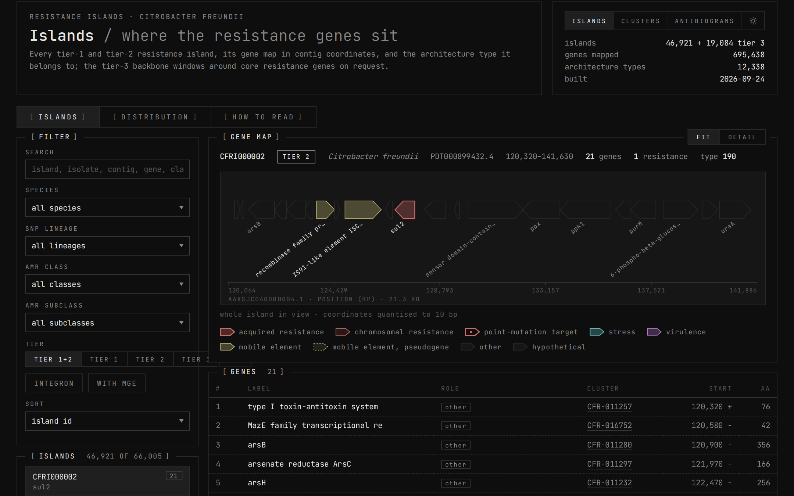
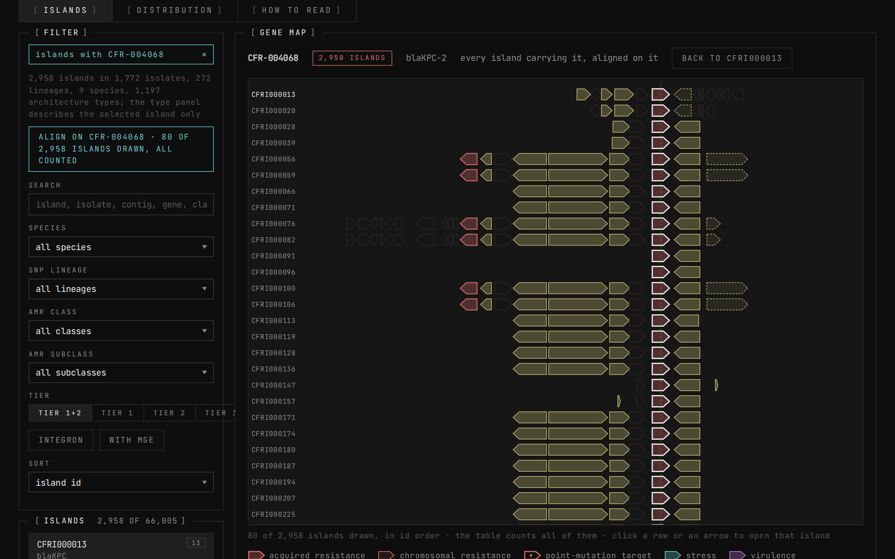
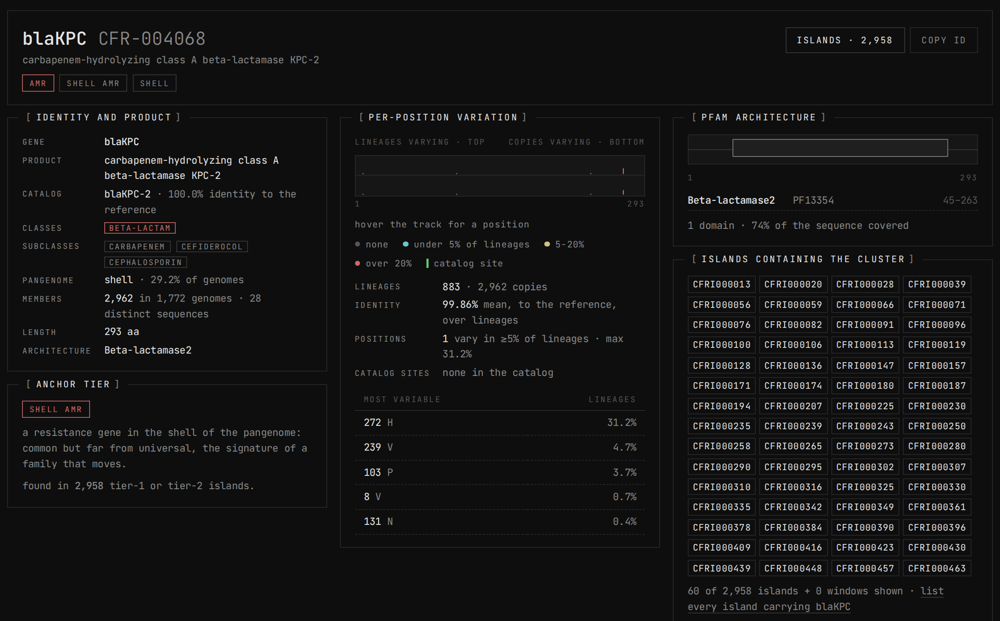
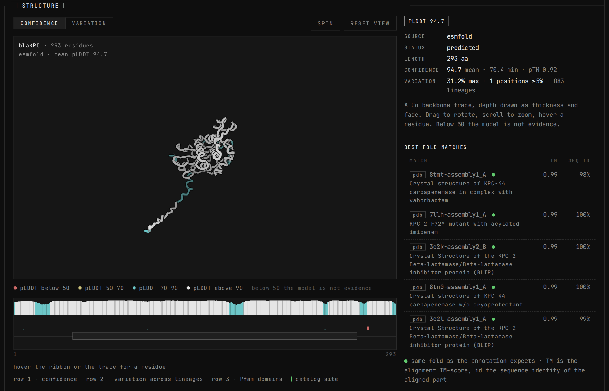
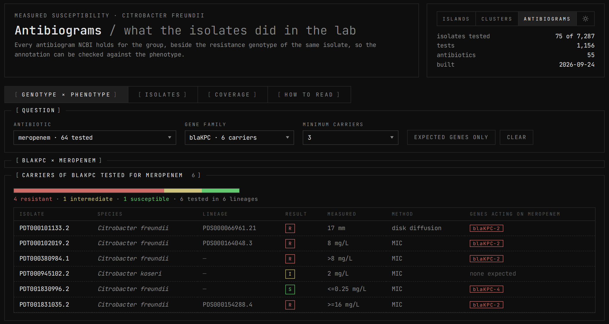

<p align="center">
  <a href="https://pedrolleao.github.io/amr-islands-dashboard/"></a>
</p>

<h1 align="center">AMR islands dashboard</h1>

<p align="center">
  From a public NCBI Pathogen Detection release to resistance profiles, resistance islands, per-lineage variation,
  predicted protein structures and an interactive dashboard, for 7,287 <em>Citrobacter freundii</em> group isolates.
</p>

<p align="center">
  <a href="https://pedrolleao.github.io/amr-islands-dashboard/"><strong>Open the live dashboard</strong></a> ·
  <a href="https://pedrolleao.github.io/amr-islands-dashboard/Citrobacter_freundii/Dashboard/islands.html">Islands</a> ·
  <a href="https://pedrolleao.github.io/amr-islands-dashboard/Citrobacter_freundii/Dashboard/clusters.html">Gene families</a> ·
  <a href="https://pedrolleao.github.io/amr-islands-dashboard/Citrobacter_freundii/Dashboard/antibiograms.html">Antibiograms</a>
  <br>
  <sub>Each page is a single self-contained HTML file of a few MB. Allow a moment for the first load. No install, no server, no account.</sub>
</p>

---

## At a glance

| | |
|---|---|
| **Input** | One public NCBI Pathogen Detection release (PDG000000039.1314), the AMRFinderPlus reference catalog, the MicroBIGG-E gene-location export and the public genome assemblies. No private data, no API key. |
| **Isolates** | 7,287 in the group (17 *Citrobacter* species) · 6,063 with a public genome, all downloaded and indexed · 3,890 placed in 925 SNP lineages · 75 with a measured antibiogram |
| **Annotation** | 608 resistance, 71 stress and 100 virulence gene symbols mapped to antibiotic class and subclass, 100 % matched · 256,528 located gene copies · per-isolate and per-lineage resistance profiles |
| **Pangenome** | 208,757 protein clusters (MMseqs2, 90 % identity / 80 % coverage) · 409 clusters anchor a known resistance gene |
| **Resistance islands** | 66,005 genomic neighbourhoods around resistance anchors (17,665 multi-resistance, 29,256 single, 19,084 chromosomal backbone controls) · 12,338 recurrent island architectures |
| **Protein level** | 806 gene families analysed in depth: per-position variation counted per lineage, 3D structure predicted for every one (ESMFold, median pLDDT 91 for resistance genes), Pfam domains, structural fold matches against PDB and AlphaFold |
| **Phenotype check** | 1,156 laboratory susceptibility tests (MIC and disk diffusion) placed beside the genotype of the same isolate |
| **Output** | Three interactive pages, rebuilt from the tables in about one minute and verified by round-trip decoding |
| **Reuse** | The same numbered pipeline, driven by one config entry per organism, was run on four further groups (*C. portucalensis*, *C. difficile*, *C. perfringens*, *C. botulinum*) |

## What this resource is

Public pathogen surveillance databases now hold tens of thousands of genomes per organism, each with a list of
resistance genes. The list says *which* genes an isolate carries. It does not say **where** they sit, **what
they travel with**, **how they vary** across lineages, **what the protein looks like**, or **whether the lab
agrees**. This project answers those questions for one organism group end to end, and packages the answers
so that a clinician, a microbiologist or a reviewer can explore them in a browser.

Everything starts from files anyone can download. A numbered Python pipeline (steps 01 to 37) turns them into
documented tables, and the last steps compile the tables into three dashboard pages that need nothing but a
browser. The pages are static files: they can be hosted anywhere, e-mailed, or opened from a USB stick.

## Explore the dashboard

### 1 · Islands: where each resistance gene sits

Every resistance gene is placed in its genomic neighbourhood, a window of ten genes on either side, merged
when windows overlap and never crossing a contig break. Each island is drawn as a gene map in contig
coordinates: coral for resistance genes, mustard for mobile elements, teal for stress and purple for
virulence genes. Islands with the same ordered arrangement of genes are grouped into **architecture types**,
so the question "is this the same mobile element everywhere?" has an answer.

Select a gene family, an antibiotic class or an architecture type and the page aligns every island that
carries it, with a conservation table underneath. Below, all 2,958 islands carrying the carbapenemase
*bla*KPC, aligned on the gene:

<p align="center"><a href="https://pedrolleao.github.io/amr-islands-dashboard/Citrobacter_freundii/Dashboard/islands.html?cluster=CFR-004068"></a></p>

Try: [every island carrying *bla*KPC](https://pedrolleao.github.io/amr-islands-dashboard/Citrobacter_freundii/Dashboard/islands.html?cluster=CFR-004068) ·
[every island with a carbapenemase](https://pedrolleao.github.io/amr-islands-dashboard/Citrobacter_freundii/Dashboard/islands.html?subclass=CARBAPENEM) ·
[every island carrying *mcr-9* (colistin)](https://pedrolleao.github.io/amr-islands-dashboard/Citrobacter_freundii/Dashboard/islands.html?cluster=CFR-008325) ·
[distribution of islands across species and lineages](https://pedrolleao.github.io/amr-islands-dashboard/Citrobacter_freundii/Dashboard/islands.html?tab=distribution)

### 2 · Gene families: one record per protein, down to the structure

One record for each of the 806 analysed families, and every other cluster of the pangenome searchable by
product, Pfam architecture, antibiotic class and subclass. A record shows identity and catalog match,
prevalence in the pangenome (core, shell or cloud), **variation at every residue counted per lineage** so that
an outbreak clone counts once, the Pfam domain architecture, and the islands the family occurs in.

<p align="center"><a href="https://pedrolleao.github.io/amr-islands-dashboard/Citrobacter_freundii/Dashboard/clusters.html?cluster=CFR-004068"></a></p>

Each record ends with the **predicted 3D structure**, drawn as a Cα trace that can be rotated and coloured by
model confidence or by where the family varies, next to the best structural matches in the PDB and AlphaFold
databases. For *bla*KPC the model reaches a mean pLDDT of 94.7 and matches the KPC-2 crystal structures at
TM-score 0.99:

<p align="center"><a href="https://pedrolleao.github.io/amr-islands-dashboard/Citrobacter_freundii/Dashboard/clusters.html?cluster=CFR-004068"></a></p>

Try: [*bla*KPC](https://pedrolleao.github.io/amr-islands-dashboard/Citrobacter_freundii/Dashboard/clusters.html?cluster=CFR-004068) ·
[*bla*NDM](https://pedrolleao.github.io/amr-islands-dashboard/Citrobacter_freundii/Dashboard/clusters.html?cluster=CFR-004495) ·
[all carbapenemase families](https://pedrolleao.github.io/amr-islands-dashboard/Citrobacter_freundii/Dashboard/clusters.html?subclass=CARBAPENEM) ·
[the stress-response set](https://pedrolleao.github.io/amr-islands-dashboard/Citrobacter_freundii/Dashboard/clusters.html?set=stress) ·
[the virulence set](https://pedrolleao.github.io/amr-islands-dashboard/Citrobacter_freundii/Dashboard/clusters.html?set=virulence)

### 3 · Antibiograms: does the lab agree with the genotype?

NCBI holds measured susceptibility for 75 isolates of the group. The page places each measurement next to the
resistance genes of the same isolate and flags the genes expected to act on that antibiotic. Pick an
antibiotic and a gene family to compare carriers with non-carriers; or read one isolate at a time.

<p align="center"><a href="https://pedrolleao.github.io/amr-islands-dashboard/Citrobacter_freundii/Dashboard/antibiograms.html?antibiotic=meropenem&family=blaKPC"></a></p>

Try: [meropenem × *bla*KPC](https://pedrolleao.github.io/amr-islands-dashboard/Citrobacter_freundii/Dashboard/antibiograms.html?antibiotic=meropenem&family=blaKPC) ·
[ciprofloxacin × *gyrA*](https://pedrolleao.github.io/amr-islands-dashboard/Citrobacter_freundii/Dashboard/antibiograms.html?antibiotic=ciprofloxacin&family=gyrA) ·
[one isolate](https://pedrolleao.github.io/amr-islands-dashboard/Citrobacter_freundii/Dashboard/antibiograms.html?isolate=PDT000050772.2)

The three pages link to each other through the address bar, so any gene, island or isolate has a URL that can
be cited.

## What was done with the dataset

| phase | steps | what it produces | method in one line |
|---|---|---|---|
| **Annotation and profiles** | 01–05 | gene → antibiotic class tables; per-isolate 0/1 resistance profiles; per-lineage summaries | the AMRFinderPlus catalog is pinned by version; every symbol is resolved allele → family → hierarchy; organism-specific choices (which subclasses to report, which marker gene) come from the data |
| **Genomes and sequences** | 06–10 | 6,063 genomes with proteins and annotation; protein and DNA sequence of every resistance, stress and virulence gene | download exactly the assembly copy NCBI annotated, so coordinates match; identical proteins collapsed by sequence |
| **Pangenome and islands** | 11–22 | 208,757 protein clusters; 409 resistance anchors tiered by prevalence; 66,005 islands; 12,338 architecture types; per-island figures; 17 QC checks | MMseqs2 clustering; anchoring at cluster level so a label reaches the copies annotation missed; fixed gene windows merged on the contig; backbone windows kept as a control tier |
| **Protein-level analysis** | 23–29 | per-position variation; 806 predicted structures; Pfam domains over the whole pangenome; fold matches | MAFFT alignments counted per lineage; ESMFold on a single 16 GB GPU with a memory protocol, ColabFold for the five longest; HMMER with Pfam 38; Foldseek against PDB and AlphaFold Swiss-Prot |
| **Dashboard** | 30–37 | three self-contained pages | a custom compact codec packs 16 MB of tables into the pages; the JavaScript decoder is generated from the Python encoder; a verifier decodes every page again and compares it with the source tables |

Full detail, every file and column, the QC that was run and the known limitations:
[`docs/DATA_DOCUMENTATION.md`](docs/DATA_DOCUMENTATION.md). A condensed narrative of the whole project with the
reasoning behind each choice: [`docs/PROJECT_HANDOFF.md`](docs/PROJECT_HANDOFF.md).

## What it can build for another organism

The pipeline is organism-independent. Every organism-specific setting lives in one entry of
[`scripts/groups.json`](scripts/groups.json): the release id, the input paths, which point-mutation taxon to
use, which antibiotic subclasses deserve their own column, which marker gene to list per isolate, and a few
spot-check assertions that fail loudly if the data does not look as expected.

- **Steps 01–10** (profiles, genomes, sequences, antibiograms, group README) have been run on five groups:
  *C. freundii*, *C. portucalensis* (581 isolates), *Clostridioides difficile* (39,708), *Clostridium
  perfringens* (5,706) and *Clostridium botulinum* (1,676). Steps 01–05 take under a minute per group.
- **Steps 11–37** (pangenome, islands, structures, dashboard) are one command each and have been run on
  *C. freundii*. Running them on another group is a matter of compute time, not new code.
- Adding a group is documented as a checklist in [`docs/WORKPLAN_new_species.md`](docs/WORKPLAN_new_species.md),
  including the data traps already met and how each was solved.

## Why the numbers can be trusted

- **Versions are pinned** (AMRFinderPlus catalog, Pfam, AlphaFold DB) and NCBI's original call is kept beside the harmonised one.
- **Lineages, not genomes, are the unit of counting** wherever variation is measured, because public databases are full of outbreak clones.
- **A protein cluster, not a gene label, is the unit of "a different gene"**; tiering on labels inflated multi-resistance 1.4×.
- **Stress and virulence genes are annotated but never define an island**; only resistance anchors do.
- **Nothing is silently missing**: every skipped or deferred item has a row and a reason, and every output folder has a README of its files and columns.
- **Predicted is not measured, and the sample is biased**: percentages are never presented as prevalence, and intrinsic chromosomal genes are listed before any class above 90 % is quoted.
- **The dashboard is verified**, not just rendered: every payload is decoded back and compared with the source tables, and the pages are screenshot-tested. This caught three silent encoding bugs that produced no error.

## Known limitations

- 1,224 isolates have no public assembly; gene absence there is unknown, not susceptibility.
- Measured antibiograms exist for 1 % of isolates: enough to spot-check a genotype, too few to validate the profiles.
- 74 % of islands touch a contig edge in draft assemblies; the 1,419 complete multi-resistance islands form the clean set.
- Putting resistance onto the SNP trees, and running steps 11–37 on the other four groups, are open items.

## Repository layout

```
latest_snps/
  scripts/                     the pipeline, numbered in running order; dashboard/ holds the page templates
  docs/                        documentation, workplans, project status, this README's images
  reference/AMRFinderPlus_*/   pinned NCBI reference catalog (7 MB)
  Citrobacter_freundii/        README of the group + Dashboard/ (the three built pages, 41 MB)
  <other groups>/              README of each group
  index.html                   redirects the GitHub Pages root to the Islands page
```

Raw NCBI downloads, genomes (59 GB) and every derived table are deliberately not in the repository; they are
rebuilt by the pipeline from public sources.

## Reproducing

```bash
python3 scripts/run_all.py --group Citrobacter_freundii           # steps 01-05: annotation and profiles (< 1 min)
python3 scripts/run_all.py --group Citrobacter_freundii --sequences   # + steps 06-08: genomes (~60 GB) and sequences
python3 scripts/09_fetch_antibiograms.py --group Citrobacter_freundii
python3 scripts/run_islands.py --group Citrobacter_freundii       # steps 11-22: pangenome and islands
python3 scripts/23_cluster_variation.py --set amr                 # steps 23-29, per set: amr | stress | virulence
python3 scripts/run_dashboard.py --group Citrobacter_freundii     # steps 30-37: payloads, pages, round-trip check
```

Requirements: Python 3 with pandas; NCBI `datasets` and `dataformat` (v2) in `tools/`; MMseqs2, MAFFT, HMMER 3.4
with Pfam 38, Foldseek 10 and a GPU with PyTorch and ESMFold for steps 11–29. The dashboard steps need only
Python.

## Documentation

| document | what it covers |
|---|---|
| [`docs/PROJECT_HANDOFF.md`](docs/PROJECT_HANDOFF.md) | the whole project in one read: inputs, every step, the numbers, design decisions, lessons |
| [`docs/DATA_DOCUMENTATION.md`](docs/DATA_DOCUMENTATION.md) | every file and column, how tables link, checks, limitations |
| [`docs/WORKPLAN_new_species.md`](docs/WORKPLAN_new_species.md) | how to add another organism group, with the traps already solved |
| [`docs/WORKPLAN_stress_virulence.md`](docs/WORKPLAN_stress_virulence.md) | the per-cluster analysis: variation, structures, domains, folds |
| [`docs/WORKPLAN_dashboard.md`](docs/WORKPLAN_dashboard.md) | dashboard design, payload schemas, the codec, verification |
| [`docs/PROJECT_STATUS.md`](docs/PROJECT_STATUS.md) | what is done, what is missing, caveats |
| [`Citrobacter_freundii/README.md`](Citrobacter_freundii/README.md) | the group: dataset composition, resistance overview, how to read it |
| [`Citrobacter_freundii/Dashboard/README.md`](Citrobacter_freundii/Dashboard/README.md) | the pages, their URLs, payloads and how to rebuild them |

## Tools and data sources

NCBI Pathogen Detection · AMRFinderPlus catalog 2026-08-07.1 · MicroBIGG-E · NCBI `datasets` v2 · NCBI BioSample
antibiograms · MMseqs2 · MAFFT · ESMFold (`facebook/esmfold_v1`) · ColabFold · HMMER 3.4 with Pfam 38.0 · Foldseek 10
against PDB and AlphaFold Swiss-Prot · Python 3 with pandas · Playwright for page verification.
